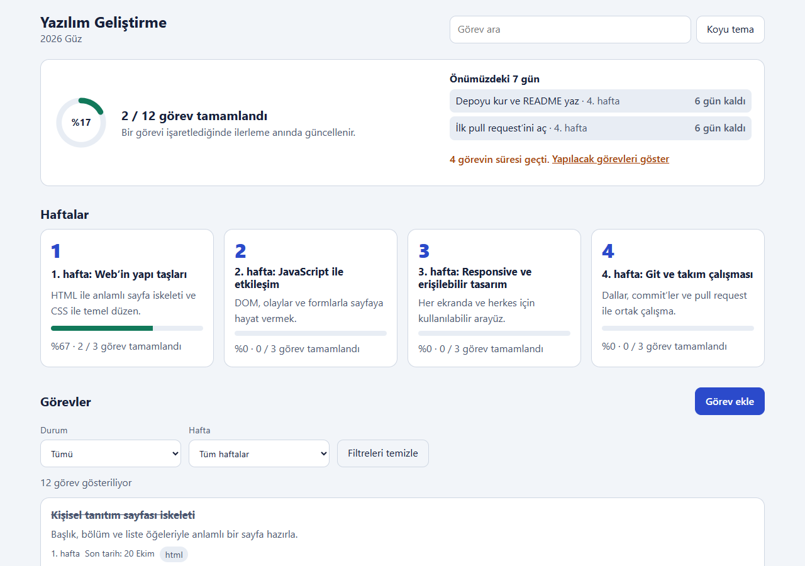

# Kısa Proje Raporu — Etkileşimli Ders Deneyimi Panosu

**Ders:** Yazılım Geliştirme | **Proje:** 1 | **Grup:** 1 | **Tarih:** 11 Kasım 2026

**Canlı demo:** https://hilalakca.github.io/YG-Proje1-Grup1/ · **Depo:** https://github.com/hilalakca/YG-Proje1-Grup1

## 1. Proje özeti
Öğrencilerin haftalık ders içeriğini, öğrenme hedeflerini, görevlerini ve ilerleme durumlarını tek sayfada takip etmelerini sağlayan istemci taraflı web uygulamasıdır. HTML5, CSS3 ve modüler JavaScript kullanılır; ek kütüphane, backend ve sunucu veritabanı yoktur. Ders içeriği `data/course.json` dosyasından gelir, öğrencinin durumu tarayıcının `localStorage` alanında saklanır.

## 2. Gereksinimler
Haftaları görüntüleme, hedeflere erişme, görev durumunu değiştirme, ilerlemeyi görme, görev arama ve durum/hafta filtrelerini birlikte kullanma temel gereksinimlerdir. Bunlara ek olarak öğrenci kendi görevini ekleyip düzenleyebilir, silebilir ve önümüzdeki 7 günde son tarihi gelen görevleri ayrı bir panelde görebilir. Gereksinim belgesinde (`gereksinimler.md`) 15 fonksiyonel ve 13 fonksiyonel olmayan gereksinim, 19 kullanıcı hikâyesi ve ölçülebilir kabul kriterleri vardır. Mobil uyumluluk, erişilebilir etiketler, klavye ile kullanım, tema kontrastı ve depolama hatalarına tolerans fonksiyonel olmayan gereksinimlerdir.

## 3. Tasarım
Tek sayfalı yapıda üst çubuk (arama, tema), genel ilerleme ve "Önümüzdeki 7 gün" paneli, hafta kartları, seçili hafta detayları, görev ekleme formu ve görev listesi bulunur. Sayfa haritası `sayfa-haritasi-ve-kullanici-akisi.md`, masaüstü wireframe `wireframes.svg`, mobil wireframe `wireframe-mobil.svg` dosyasındadır.

## 4. Teknik uygulama
`index.html` semantik iskeleti; `css/styles.css` tema ve responsive düzeni; `js/main.js` arayüz çizimi ve olayları; `js/logic.js` doğrulama, Türkçe metin normalizasyonu, ilerleme, filtre, form doğrulaması ve yaklaşan görev hesabını; `js/storage.js` hata toleranslı `localStorage` işlemlerini; `data/course.json` örnek ders içeriğini sağlar. İş mantığı DOM'a dokunmayan saf fonksiyonlardan oluştuğu için birim testleriyle doğrudan denenebilir.

## 5. Doğrulama ve test
**Otomatik testler:** `tests/` klasöründe üç dosyada 65 birim testi vardır (iş mantığı, örnek verinin tutarlılığı, `localStorage` dayanıklılığı). Testler her push ve PR'da GitHub Actions'ta çalışır; teslim günü itibarıyla 65 testin hepsi geçmektedir.

**Elle yapılan testler:** `test-senaryolari.md` belgesinde 25 senaryo (TC-01–TC-25) temel özellikleri, görev formunu, "Önümüzdeki 7 gün" panelini, 360/768/1280 px ekran genişliklerini, klavye kullanımını, kontrastı ve form etiketlerini kapsar; 15 fonksiyonel gereksinim test senaryolarıyla eşleştirilmiştir.

**Bulunan ve düzeltilen hatalar:**

- #66: Gecikme kontrolü bugünü UTC'ye göre hesaplıyordu.
- #94: Sekme simgesi eksikti, konsolda 404 hatası çıkıyordu.
- #93: Hafta kartında başlık düğmenin içindeydi.
- #98: Hafta kartı klavyeyle açılınca odak kayboluyordu.
- #111: Görev formu sayfa açılışında görünüyor, Vazgeç ve Esc onu gizlemiyordu (CSS'te `display` kuralı `hidden` özelliğini eziyordu).

Teslim günü bilinen açık hata yoktur.

## 6. Ekip ve süreç
Hocanın takip listesindeki 20 madde GitHub issue'su ve alt görevlere bölündü, GitHub Projects panosunda izlendi. Her iş `main`'den açılan bir dalda yapıldı, PR ile incelendi ve otomatik testler geçtikten sonra birleştirildi. Kişi bazında commit, PR ve inceleme sayıları `katki-tablosu.md` dosyasındadır.

| Üye | Rol | Başlıca katkı |
| --- | --- | --- |
| Hilal Akça | Lider + Geliştirici | Uygulama kodu, görev panosu ve süreç, ilerleme ve tema, görev formu, 7 gün paneli, canlı demo, entegrasyon testi, belgeler ve teslim |
| Fatih Ulupınar | Analist + Geliştirici | Kullanıcı hikâyeleri, gereksinim belgesi, veri ve depolama testleri |
| Yusuf Veis | Test / Kalite + Geliştirici | Birim testleri, GitHub Actions, test senaryoları ve hata kayıtları, hafta kartı erişilebilirlik düzeltmesi |
| Ayşe Yurtseven | Dokümantasyon + Geliştirici | Sayfa haritası, masaüstü ve mobil wireframe, kullanıcı kılavuzunun ve raporun ilk sürümü, sunum taslağı |

## 7. Sınırlamalar
Kullanıcı ilerlemesi yalnızca kullanılan tarayıcıda saklanır ve cihazlar arasında eşitlenmez. Backend, kullanıcı hesabı ve merkezi raporlama kapsam dışıdır. "Ders yolculuğu (zaman çizelgesi)" görünümü (US-16) uygulanmamıştır; haftalar kart ızgarasıyla gösterilir.

## 8. Sonuç
Uygulama hocanın teknik dokümanındaki zorunlu işlevlerin hepsini karşılar, haftalık ders akışını ve görev ilerlemesini tek arayüzde birleştirir ve GitHub Pages'te yayındadır. Sonraki sürümde zaman çizelgesi görünümü ve cihazlar arası eşitleme ele alınabilir.
