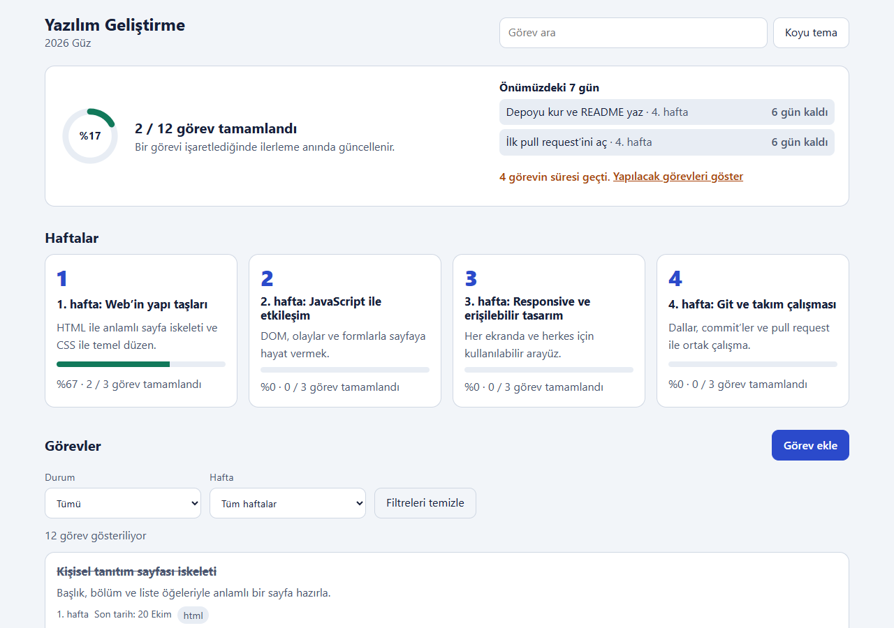
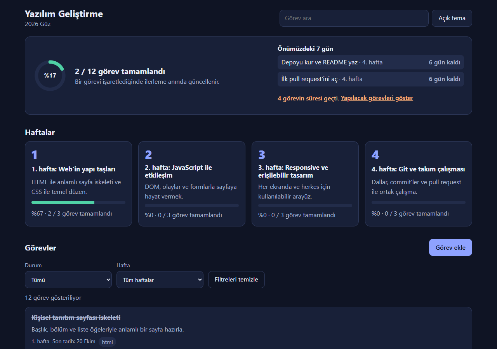
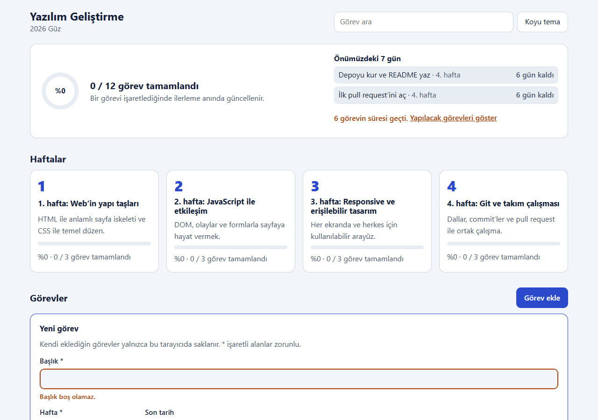
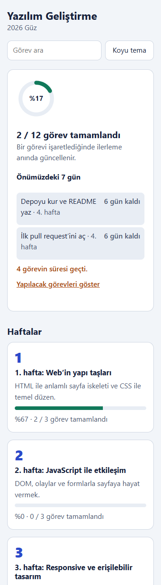

# Kullanıcı Kılavuzu

## Uygulamayı açma
**En kolayı:** Canlı demoyu tarayıcıda açın: https://hilalakca.github.io/YG-Proje1-Grup1/ (kurulum gerekmez).

Kendi bilgisayarınızda çalıştırmak için:
1. Proje klasörünü indirin ve VS Code ile açın.
2. `index.html` dosyasını Live Server ile açın. Alternatif olarak terminalde `python -m http.server 8000` komutunu çalıştırıp `http://localhost:8000` adresine gidin.
3. `fetch` ve ES modülleri kullanıldığı için dosyayı çift tıklayarak açmayın; yerel sunucu kullanın.

## Genel ilerleme ve önümüzdeki 7 gün

Sayfanın üstündeki halka, tamamlanan görevlerin yüzdesini ve "tamamlanan / toplam" sayısını gösterir.

Yanındaki **Önümüzdeki 7 gün** bölümü, bugün ve sonraki 7 gün içinde son tarihi olan ve henüz tamamlanmamış en fazla 5 görevi, en yakını başta olacak şekilde listeler ("Bugün", "Yarın", "4 gün kaldı"). Süresi geçmiş görev varsa sayısı yazılır; **Yapılacak görevleri göster** düğmesi görev listesini "Yapılacak" durumuna süzer ve listeye götürür.

## Haftalar
Hafta kartına tıklayarak öğrenme hedeflerini ve varsa kaynak bağlantılarını açın. Aynı karta tekrar tıklayarak tüm haftalara dönün. Kartın altındaki çubuk ve yüzde, o haftanın görevlerinden kaçının tamamlandığını gösterir.

## Arama ve filtreler
Üstteki Görev ara alanı başlık, açıklama ve etiketlerde arama yapar; büyük/küçük harf ve Türkçe karakter farkı gözetmez ("İŞ" ile "iş" aynı sonucu verir). Durum ve hafta filtrelerini seçebilirsiniz. Birden fazla koşul birlikte VE (AND) mantığıyla uygulanır. Kaç görevin gösterildiği listenin üstünde yazar. Filtreleri temizle düğmesi tüm filtreleri varsayılana döndürür.

## Görev durumu ve tema

Her görev kartında Yapılacak, Devam ediyor veya Tamamlandı durumlarından birini seçin. İlerleme göstergeleri sayfa yenilenmeden güncellenir. Son tarihi geçmiş ve tamamlanmamış görevlerde tarih "Süresi geçti: …" olarak vurgulanır. Üst çubuktaki düğme açık/koyu tema arasında geçiş yapar.

## Kendi görevini ekleme, düzenleme ve silme

1. Görevler bölümündeki **Görev ekle** düğmesine basın; form açılır.
2. **Başlık** ve **Hafta** zorunludur. **Son tarih**, **Açıklama** ve **Etiketler** isteğe bağlıdır. Etiketleri virgülle ayırın (en çok 5 etiket, örnek: `ödev, okuma`).
3. **Kaydet**'e basın. Eksik ya da hatalı alan varsa altında kırmızı bir mesaj çıkar ve imleç o alana gider. Başlık en çok 120, açıklama en çok 500 karakter olabilir.
4. Eklediğiniz görev listede **Kendi görevim** etiketiyle görünür ve ilerleme hesabına katılır.
5. Kendi görevinizi değiştirmek için kartındaki **Düzenle**'ye, silmek için **Sil**'e basın; silmeden önce onay istenir. Ders içeriğinden gelen görevler düzenlenemez ve silinemez.

Formu **Vazgeç** düğmesiyle ya da **Esc** tuşuyla kapatabilirsiniz. Eklediğiniz görevler yalnızca kullandığınız tarayıcıda saklanır.

## Telefonda kullanım
Uygulama telefon ekranında tek sütuna geçer; tüm düğmeler parmakla rahat basılacak büyüklüktedir (en az 44 px).

## Klavyeyle kullanım
Sayfa açılınca ilk **Tab**, "Görevlere geç" bağlantısını gösterir; **Enter** ile doğrudan görev listesine gidilir. Tüm düğme, filtre ve form alanlarına **Tab** ile ulaşılır ve **Enter** / **Boşluk** ile kullanılır.

## İlerlemeyi sıfırlama
Alt bölümdeki İlerlemeyi sıfırla düğmesine basın ve onay penceresini kabul edin. Kayıtlı ilerleme, eklediğiniz görevler ve tercihler (tema, filtreler) temizlenir; işlem geri alınamaz.

## Veri ve gizlilik
Ders içeriği `data/course.json` dosyasından gelir. Görev durumları, eklediğiniz görevler ve tercihler kullanılan tarayıcının `localStorage` alanında saklanır; sunucuya gönderilmez. Kayıtlar bozulursa uygulama çökmeden varsayılan değerlerle açılır. Tarayıcı depolamaya izin vermezse uygulama çalışmaya devam eder ve sayfanın üstünde "verileri kalıcı olarak saklayamıyor" uyarısı gösterir.
